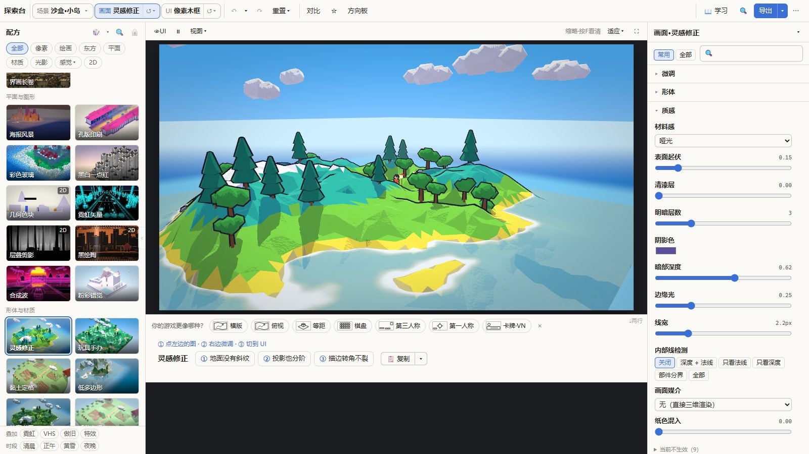
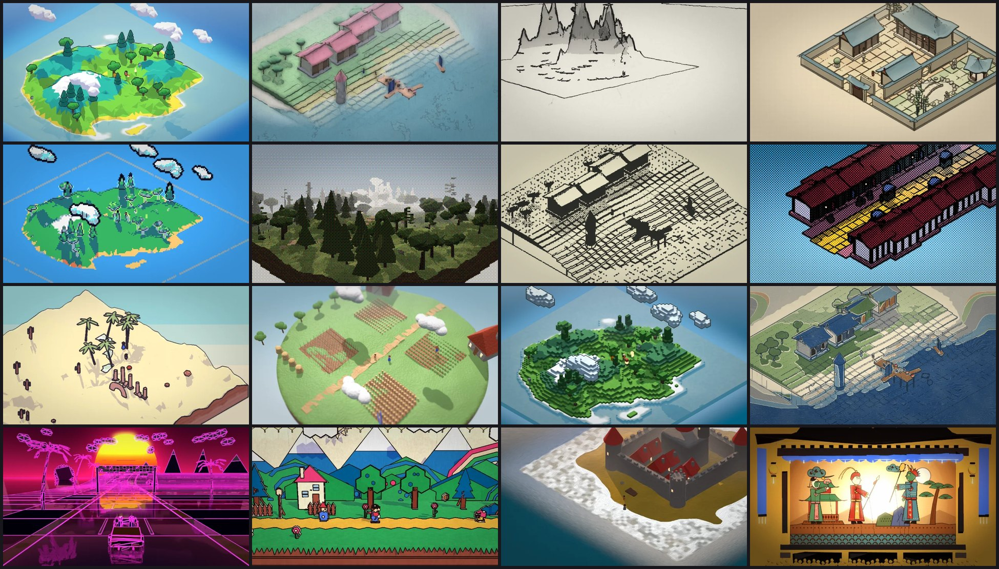
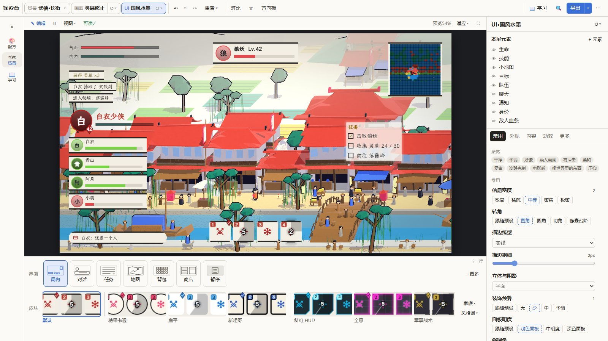
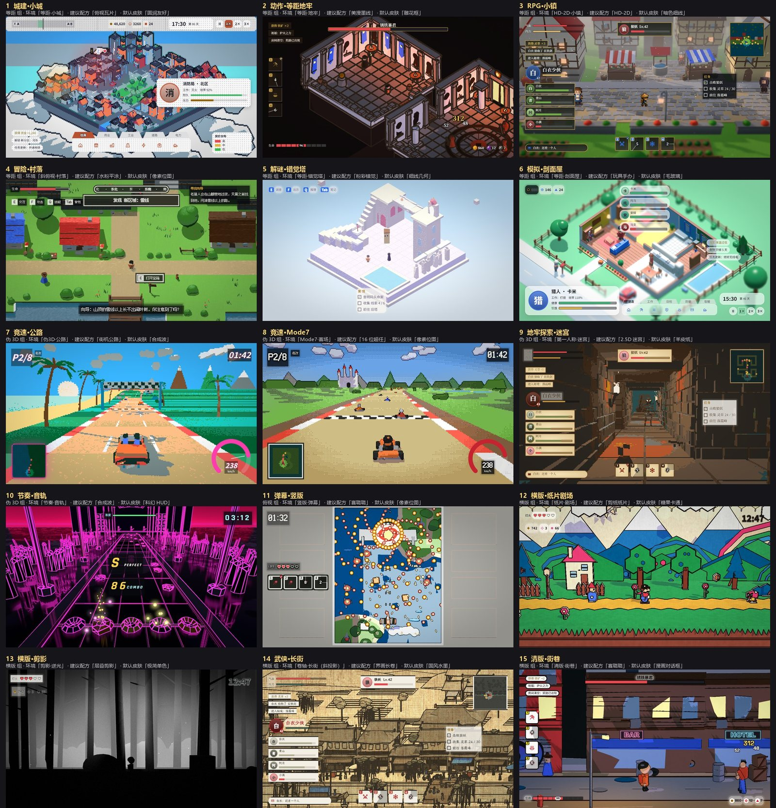

# Game Art Style Explorer

[](https://github.com/EC2EZ4RD/game-art-explorer/actions/workflows/ci.yml) · [中文](README.md) · **[Live demo](https://ec2ez4rd.github.io/game-art-explorer/)**

A browser tool for game developers who aren't artists. It breaks "art style" down into options along dimensions such as shape, shading, outlines, painterly medium, color, lighting, camera and UI. You tweak them in real time, compare side by side, and learn the vocabulary as you go. Then you export an accurate description of the picture, a coding prompt for AI assistants, a reproducible parameter recipe, or a Godot 4 port package.

The interface and most of the research notes are in Chinese.



## Why

Take a typical prompt for a "low-poly miniature sandbox". Every line is really one option on one dimension: simplex-noise terrain, flat shading, a 3-step toon ramp, inverted-hull outlines, a saturated palette, an orthographic isometric camera, and so on. A style is a combination of such options. This tool lays out the dimensions and as many options as possible, so you can find the look you want without an art background and explain how it is made.

## Features

- **Picture styles**: 86 recipes (watercolor, ink wash, gongbi, pixel art, PS1, 1-bit, manga halftone, claymation, voxel, ukiyo-e, paper cut, oil, shadow puppetry and more; 37 run fully in real time), built from 274 picture parameters across 13 dimensions.
- **Game UI**: 658 UI parameters (932 parameters in total with the picture ones) and 38 skins. You click, drag and restyle HUD elements directly on the canvas. It also has 24 genre content packs and structural recreations of 26 well-known HUDs.
- **Scenes**: 59 scenes in 34 categories of places and views, such as natural landscapes, forests, towns, interiors, sci-fi facilities, side-scrolling, top-down tiles, isometric 2.5D, pseudo-3D and race tracks. The same layout can switch geometry representation and camera.
- **Learning library**:
  - 227 style entries, 36 mood words and 34 cultural themes
  - 100 palettes
  - 361 game case studies, 200 of them with item-by-item visual breakdowns
  - 452 UI reference cards and 85 UI design principles

  Every entry can be loaded into the experiment.
- **Comparison**: A/B split, diagnostic views (grayscale, 3-value, silhouette), undo/redo, favorites and a direction board.
- **Export**:
  - screenshot
  - picture description
  - style brief
  - art prompt, with a technical check
  - coding prompt
  - parameter JSON

  In developer mode you can also export a Godot 4 package: `.gdshader` files, material and environment settings, and per-item porting notes.
- **Prompt check**: paste an art or tech prompt. The tool maps what it recognizes onto parameters and loads them. It also flags common technical mistakes, such as expecting "PCF hard shadows" or combining flat shading with inverted-hull outlines.







## Quick start

Requires Node.js 20.19+ or 22.12+ (the Vite 8 requirement).

```bash
npm install
```

```bash
npm run dev
```

Open http://localhost:5188.

- The "场景" (scene) tab in the top bar opens the scene picker. The "画面" (picture) and "UI" tabs switch between picture mode and UI mode (keys `1` / `2`). Each tab shows the current recipe or skin and the number of changes, and its ▾ menu resets them.
- The left column is the gallery: recipes in picture mode, scenes in UI mode. The right column holds the parameters of the current layer. In UI mode, the strip under the frame switches screens and skins.
- `Ctrl+K` searches recipes, styles, scenes and parameters. "📖 学习" opens the learning library. The "⋯" menu has developer mode, theme, recipe import and the shortcut list.

To build a static site:

```bash
npm run build
```

The output goes to `dist/` and uses relative paths, so it works on any static host. A GitHub Pages workflow is included. `npm run build:single` packs the app into one HTML file (`dist-single/`), but without the textures, thumbnails and swatches under `public/`. Effects that need textures (paper, brush strokes, cun strokes, pixel sprites, 2D effects, carved UI frames) and gallery thumbnails don't work in the single-file version. For the full experience, use `npm run build` with a static host, or `npm run preview`. When you distribute the single-file version, include `dist/third-party-licenses.md` (generated by `npm run build`), `THIRD_PARTY_NOTICES.md` and `public/fonts/`.

## Scripts

| Command | Purpose |
|---|---|
| `npm run dev` | Dev server on port 5188 |
| `npm run build` | Typecheck and production build to `dist/` |
| `npm run build:single` | Single-file HTML to `dist-single/` |
| `npm run typecheck` | Typecheck web code and scripts |
| `npm run check:content` | Content consistency checks (parameters, recipes, palettes, scenes, styles, cases, assets, fonts) |
| `npm test` | Unit tests: UI readability, world-space UI, UI knowledge base, state and reset, scene registry |
| `npm run check:godot` | Export every recipe to Godot, run each in a local Godot 4, take screenshots and collect shader errors (optional) |
| `npm run check:godot:ui` | Same, for the game UI exports only |
| `npm run dump:registry` | Dump the parameter registry to `docs/registry.json` for external tools (generated, not committed) |

## What is not in the repository

To avoid redistributing copyrighted third-party images, the following are **not included**. Without them, the tool shows names and source links instead.

- **Game screenshots** (Steam store images, about 300 MB). To fetch them locally:

  ```bash
  node scripts/cases/screens.mjs
  ```

  ```bash
  node scripts/cases/download.mjs
  ```

  They are saved to `public/cases/<appid>/` with a `provenance.json`. The dev server shows them only when that folder exists, and production builds never copy it.
- **UI reference screenshots**: kept in the author's local `qa/refs-cache/` and not published. Images from GameUI and Interface In Game may not be redistributed under those sites' terms, and the download scripts are not published either. Reference cards show the game name and links; the dev server shows screenshots only when that folder exists.
- **Raw AI-generated images and generation logs**: only the processed textures (`public/assets/tex/`) are included. See [docs/assets.md](docs/assets.md).

Keep any screenshots you fetch for local study only. Please do not redistribute them.

## Godot 4

Every parameter records its Godot 4 counterpart: a built-in setting, a custom shader, a post-process pass or a script. It also records how hard the port is.

To export a port package, turn on developer mode in "⋯", then choose "导出 ▾ → Godot 迁移包". The result is a project Godot can open directly.

`npm run check:godot` opens a 960×540 Godot window for each recipe's package in turn, takes a screenshot and collects shader errors. It needs a desktop session and a GPU. Install Godot 4 and tell the script where it is:

```bash
GODOT=/path/to/godot npm run check:godot
```

On Windows, point `GODOT` at the `*_console.exe`. Without `GODOT`, the script looks for `godot` on `PATH`. This step is optional and not part of CI.

## Project layout

```
src/dims/      parameter registry (plain-language notes, terms, prompt fragments, conditions, Godot notes)
src/engine/    rendering: loop, camera, materials and shaders, post-processing, scenes and terrain
src/hud/       game UI: elements, skins, icons, content packs, layout and readability checks
src/content/   data: recipes, style atlas, palettes, scenes, case library, UI knowledge, asset registry
src/export/    exports: descriptions, prompts, prompt check, recipes, Godot package
src/ui/        React interface
scripts/       checks, tests, Godot validation, font subsetting, data collection, asset processing
docs/          requirements, research (docs/survey/), design docs
```

Most things are data entries, so adding a parameter, medium, scene, recipe, style or palette rarely touches the engine core. New UI skins are `kind: "skin"` presets in `docs/survey/data/ui-param-system.json` (then run `npx tsx scripts/ui-spec-build.ts`). Run `npm run check:content` and `npm test` after changes. See [CONTRIBUTING.md](CONTRIBUTING.md).

## Documentation (Chinese)

- [docs/requirements.md](docs/requirements.md): product vision and requirements
- [docs/survey/](docs/survey/): research (style taxonomy, rendering techniques, cases and data sources, Chinese architecture and painting, palettes, genre cameras and UI, UI design principles and style atlas)
- [docs/workbench-redesign.md](docs/workbench-redesign.md): information architecture and interaction design of the current UI
- [docs/tech/](docs/tech/): technique gap-filling plan and summary
- [docs/assets.md](docs/assets.md): asset sources, processing and license

## License

- Code: [MIT](LICENSE)
- Documentation and research data (`docs/` except `docs/images/`, the Markdown docs in the repo root and `src/dev/`, JSON under `src/content/`): [CC BY 4.0](https://creativecommons.org/licenses/by/4.0/)
- Textures in `public/assets/tex/` and the tool's own renders (`public/thumbs/`, `public/swatches/`, `docs/images/`): [CC0 1.0](https://creativecommons.org/publicdomain/zero/1.0/)
- Font subsets: SIL OFL 1.1, see [public/fonts/LICENSES.md](public/fonts/LICENSES.md)

Suggested credit when reusing the docs or data: "Game Art Style Explorer (game-art-explorer) by EC2EZ4RD, https://github.com/EC2EZ4RD/game-art-explorer, CC BY 4.0", and note any changes you made.

[THIRD_PARTY_NOTICES.md](THIRD_PARTY_NOTICES.md) has the per-directory license table, dependencies, data sources (the Riso ink palettes keep their MIT license) and trademarks. Game titles and trademarks belong to their owners. The case breakdowns are personal observations, not statements by the developers.
