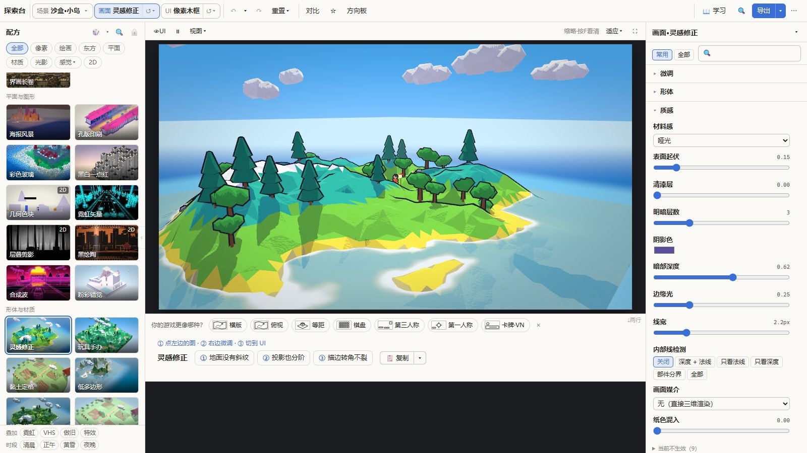
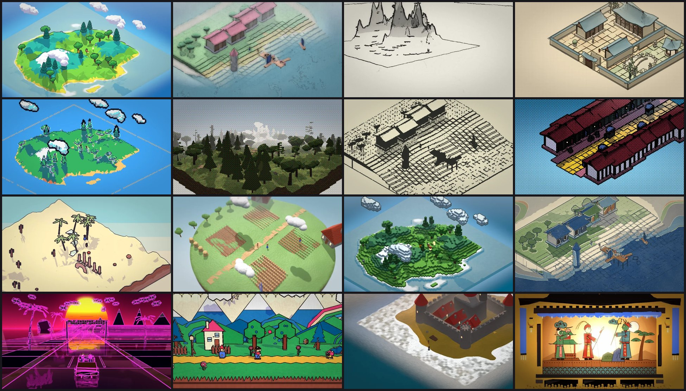
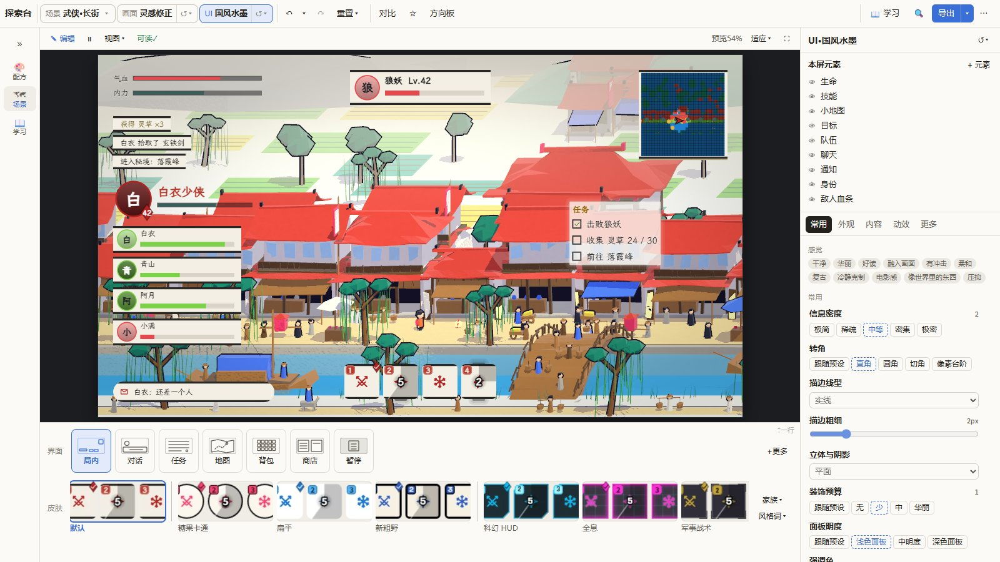
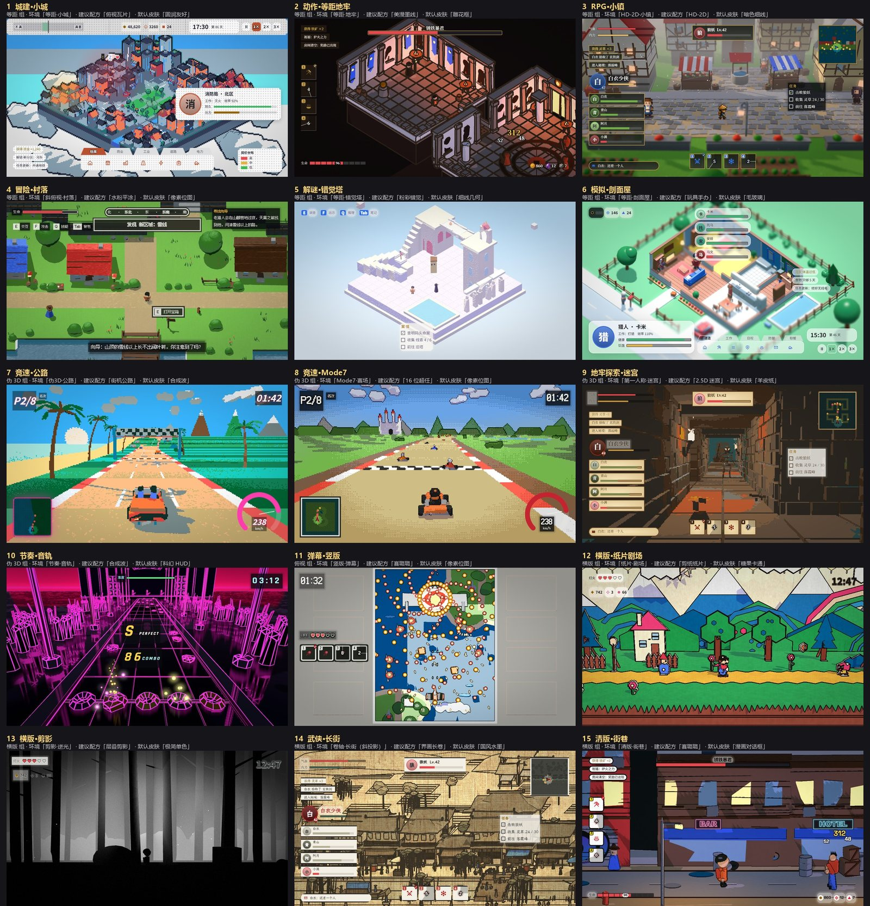

# 游戏美术风格探索台

[](https://github.com/EC2EZ4RD/game-art-explorer/actions/workflows/ci.yml) · [English](README.en.md) · **[在线体验](https://ec2ez4rd.github.io/game-art-explorer/)**

一个给不熟悉美术的游戏开发者用的网页工具：把"美术风格"拆成形状、着色、描边、画面媒介、色彩、灯光、镜头、UI 等维度上的选项，实时调整、并排比较、边看边学术语，最后导出准确的画面描述、AI 编码提示词、可复现的参数配方和 Godot 4 迁移包。



## 为什么做这个

一段"低多边形微缩沙盒"的提示词里，每一行其实都是某个维度上的一个选项：Simplex 噪声地形、面着色、3 阶卡通明暗、反向外壳描边、高饱和色板、正交等距镜头……风格就是这些选项的组合。这个工具把维度和尽可能多的选项都摆出来，让你不靠美术功底也能找到想要的画面，并且说得清它是怎么做出来的。

## 能做什么

- **画面风格**：86 套配方（水彩、水墨、工笔、像素、PS1、1-bit、网点漫画、黏土、体素、浮世绘、剪纸、油画、皮影……其中 37 套完全实时），画面参数 274 个、分布在 13 个维度。
- **游戏 UI**：658 个 UI 参数（加上画面参数共 932 个）、38 套皮肤，在画面上直接点选、拖动、改样式；24 个品类内容包、26 款名作 HUD 的结构复刻。
- **场景**：59 个场景覆盖 34 类场所与视角（自然、林地、城镇、室内、科幻设施、横版卷轴、俯视瓦片、等距 2.5D、伪 3D、赛道等），同一布局可以切换几何表示和镜头。
- **学习库**：227 种风格的研究条目、36 个情绪词、34 个文化题材、100 套色板、361 个游戏案例（200 款有逐项视觉拆解）、452 张 UI 参考卡、85 条 UI 设计原则。每一项都能"载入到实验里"看效果。
- **比较**：A/B 分割、诊断视图（灰度、三级明度、剪影）、撤销 / 重做、收藏与方向板。
- **导出**：截图、画面说明、风格说明书、美术提示词（附技术体检）、编码提示词、参数 JSON；开发者模式下还能导出 Godot 4 迁移包（`.gdshader` + 材质与环境设置 + 逐项迁移说明）。
- **提示词体检**：粘贴一段美术或技术提示词，工具认出能映射成参数的部分并载入，同时标出常见的技术误区（例如"PCF 硬阴影"、面着色与外壳描边冲突）。







## 快速开始

需要 Node.js 20.19+ 或 22.12+（Vite 8 的要求）。

```bash
npm install
```

```bash
npm run dev
```

打开 http://localhost:5188 。

- 顶栏的「场景」标签打开场景选择；「画面」「UI」标签切换到画面模式 / UI 模式（快捷键 `1` / `2`），标签上显示当前的配方 / 皮肤和改动数，▾ 里可以重置。
- 左栏是图库（画面模式选配方，UI 模式选场景），右栏是当前层的参数；UI 模式下画框底部可以换界面和皮肤。
- `Ctrl+K` 搜索配方、风格、场景、参数；右上角「📖 学习」打开学习库；「⋯」里有开发者模式、主题、导入配方和快捷键表。

构建静态网页：

```bash
npm run build
```

产物在 `dist/`，用相对路径，可以直接放到任何静态托管上（仓库自带 GitHub Pages 工作流）。`npm run build:single` 会把网页打成一个单文件 HTML（`dist-single/`），但不含 `public/` 下的纹理素材、缩略图和色票：依赖纹理的效果（纸纹、笔触、皴法、像素角色、2D 特效、UI 雕花框）和图库缩略图在单文件版里不可用。想看完整效果请用 `npm run build` 加静态托管，或 `npm run preview`。分发单文件版时请附带 `dist/third-party-licenses.md`（`npm run build` 生成）、`THIRD_PARTY_NOTICES.md` 和 `public/fonts/`。

## 命令

| 命令 | 作用 |
|---|---|
| `npm run dev` | 开发服务器（端口 5188） |
| `npm run build` | 类型检查 + 生产构建到 `dist/` |
| `npm run build:single` | 单文件 HTML 到 `dist-single/` |
| `npm run typecheck` | 类型检查（网页代码 + 脚本） |
| `npm run check:content` | 内容一致性检查：参数说明、配方、色板、场景覆盖、风格能力、案例、素材、字体 |
| `npm test` | 单元测试：UI 可读性、世界空间 UI、UI 知识库、状态与重置、场景注册表 |
| `npm run check:godot` | 为每套配方生成 Godot 迁移包，用本机 Godot 4 逐个运行、截图并收集着色器错误（可选，见下文） |
| `npm run check:godot:ui` | 同上，只检查游戏 UI 部分 |
| `npm run dump:registry` | 把参数注册表导出到 `docs/registry.json`，给外部工具用（生成文件，不入库） |

## 仓库里没有的东西

为了避免再分发第三方受版权保护的图片，下面这些**不在仓库里**，工具在没有它们时改为显示名字和来源链接：

- **游戏案例截图**（Steam 商店截图，约 300 MB）。需要的话可以在本地抓取：

  ```bash
  node scripts/cases/screens.mjs
  ```

  ```bash
  node scripts/cases/download.mjs
  ```

  截图会存到 `public/cases/<appid>/`，并附 `provenance.json`。开发服务器检测到这个目录后才会显示截图；生产构建不会复制它。
- **UI 参考卡截图**：调研时存在作者本地的 `qa/refs-cache/`，不随仓库发布（来自 GameUI、Interface In Game 的参考图按站点条款不能转载，下载脚本也没有发布）。参考卡会显示游戏名和链接；开发服务器检测到这个目录时才显示截图。
- **AI 生成素材的原图与生成记录**：仓库里只有处理后的成品（`public/assets/tex/`），见 [docs/assets.md](docs/assets.md)。

这些截图只供本地学习参考，请不要再分发。

## Godot 4 迁移与校验

每个参数都登记了 Godot 4 的对应做法（内置设置、自定义着色器、后处理或脚本）与迁移难度。在「⋯ → 开发者模式」打开后，「导出 ▾ → Godot 迁移包」会生成一个可以直接用 Godot 打开的工程。

`npm run check:godot` 会在本机逐个打开 Godot 窗口（960×540），运行每套配方的迁移包、截图并收集着色器错误，需要桌面环境和显卡。先装 Godot 4，再让脚本找到它：

```bash
GODOT=/path/to/godot npm run check:godot
```

Windows 请指向 `*_console.exe`。不设 `GODOT` 时脚本会找 `PATH` 上的 `godot`。这一步不是必需的，CI 里也不跑。

## 代码结构

```
src/dims/        维度与参数注册表：每个参数有白话说明、两端效果、术语、提示词片段、生效条件、Godot 迁移说明
src/engine/      渲染：运行循环、相机、材质与着色器、后处理链、场景与地形、角色、粒子
src/hud/         游戏 UI：元素、皮肤、图标、内容包、排版与可读性检查
src/content/     数据：配方、风格图谱、色板、场景目录、案例库、UI 知识库、素材登记表
src/export/      导出：画面说明、提示词、提示词体检、可复现配方、Godot 迁移包
src/ui/          React 界面（顶栏、图库、舞台、调参台、学习库、对话框）
scripts/         内容检查、单元测试、Godot 校验、字体子集化、案例与参考数据抓取、素材处理
docs/            需求、调研（docs/survey/）、设计文档、技术说明
```

## 扩展

几乎所有可调的东西都是数据条目，新增一般不用改引擎核心：

- **新参数 / 选项**：在 `src/dims/<维度>.ts` 加一条 `ParamDef`，写清白话、两端效果、生效条件与 `port.godot`；着色器需要的 uniform 加到 `src/engine/materials/`。
- **新画面媒介**：在 `src/engine/post/` 写片元着色器并在管线里注册，在 `src/dims/surface.ts` 加选项，在 `src/export/godot.ts` 补 Godot 版本。
- **新场景**：在 `src/content/sceneCatalog.ts` 登记，在 `src/engine/scene/scenes/` 用 `registerSceneBuilder` 搭建。
- **新配方**：在 `src/content/recipes.ts` 追加，写清看哪里、先调哪几项、与相邻风格的区别、已实现与缺口。
- **新风格**：在 `src/content/styles.data.ts` 追加；能力状态（可实时 / 局部 / 需素材 / 待补充）由已实现的参数自动算出。
- **新色板**：在 `src/content/palettes.ts` 登记，带出处的色值写进 `docs/survey/data/palettes.json`，再复制一份到 `src/content/palettes.survey.json`。
- **新 UI 皮肤**：在 `docs/survey/data/ui-param-system.json` 的 `presets` 里加一条 `kind` 为 `skin` 的预设，再运行 `npx tsx scripts/ui-spec-build.ts` 重新生成 `src/content/uiSpec.gen.json`。
- **新内容包**（品类的示例文字与样本数据）：见 `src/hud/content/packs/`。改了 UI 文字后如果 `check:content` 报字体子集缺字，见 [CONTRIBUTING.md](CONTRIBUTING.md)。

改完运行 `npm run check:content` 和 `npm test`。更多见 [CONTRIBUTING.md](CONTRIBUTING.md)。

## 文档

- [docs/requirements.md](docs/requirements.md)：产品愿景与需求
- [docs/survey/](docs/survey/)：调研（风格分类、渲染技术、案例与数据源、中国传统建筑与绘画、色板、品类镜头与 UI、UI 设计原则与风格图谱）
- [docs/workbench-redesign.md](docs/workbench-redesign.md)：当前界面的信息架构与交互设计
- [docs/tech/](docs/tech/)：技术补全计划与总结
- [docs/assets.md](docs/assets.md)：素材来源、处理流程与许可

## 许可

- 代码：[MIT](LICENSE)
- 文档与调研数据（`docs/`，`docs/images/` 除外；根目录与 `src/dev/` 下的说明文档；`src/content/` 下的 JSON）：[CC BY 4.0](https://creativecommons.org/licenses/by/4.0/)
- `public/assets/tex/` 里的素材，以及工具自己渲染的图（`public/thumbs/`、`public/swatches/`、`docs/images/`）：[CC0 1.0](https://creativecommons.org/publicdomain/zero/1.0/)
- 字体子集：SIL OFL 1.1，见 [public/fonts/LICENSES.md](public/fonts/LICENSES.md)

转载或改编文档与调研数据时，请这样署名：「游戏美术风格探索台（game-art-explorer），EC2EZ4RD，https://github.com/EC2EZ4RD/game-art-explorer ，CC BY 4.0」，有修改请注明。

逐目录的许可表、第三方依赖、色板与数据来源（Riso 油墨色板沿用 MIT 许可）、商标说明见 [THIRD_PARTY_NOTICES.md](THIRD_PARTY_NOTICES.md)。游戏名与商标归各自权利人所有；案例拆解是个人观察，不代表开发者的官方说法。
